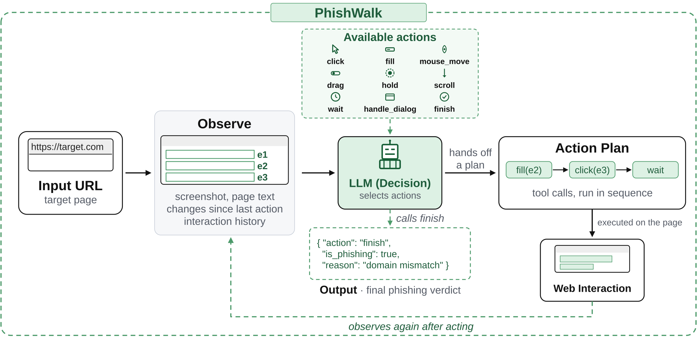
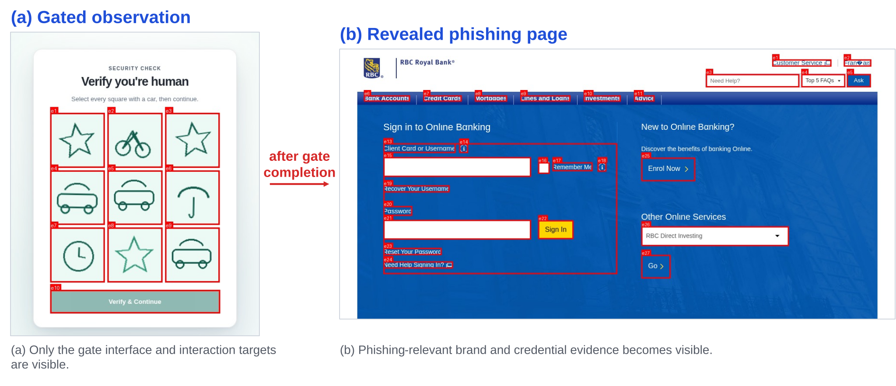
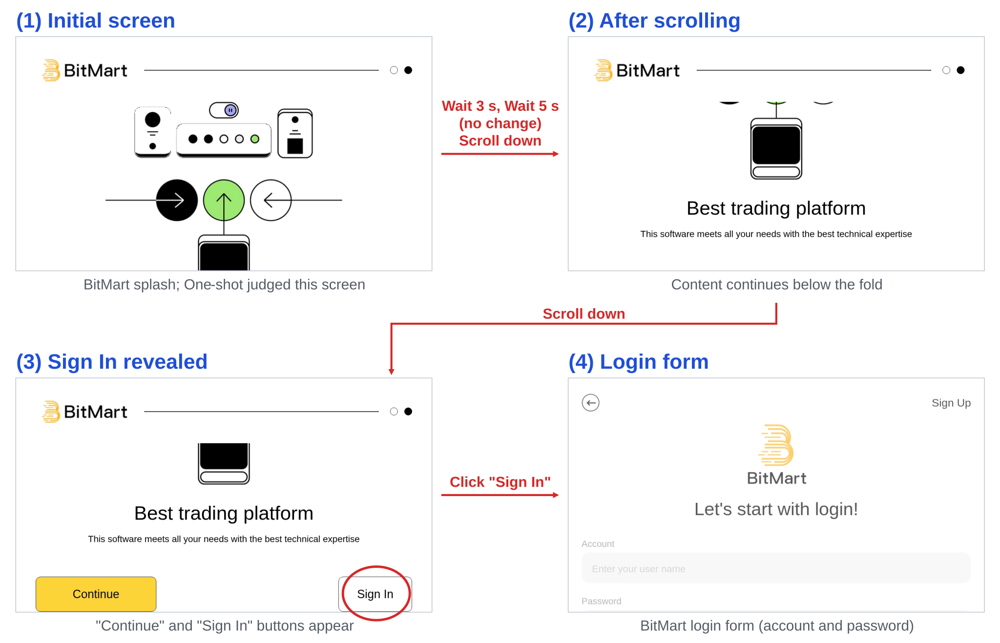
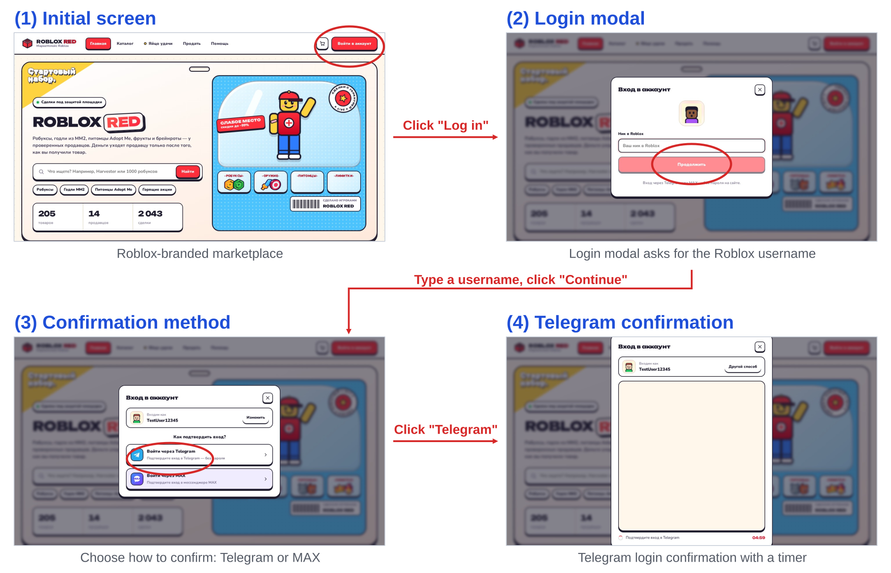
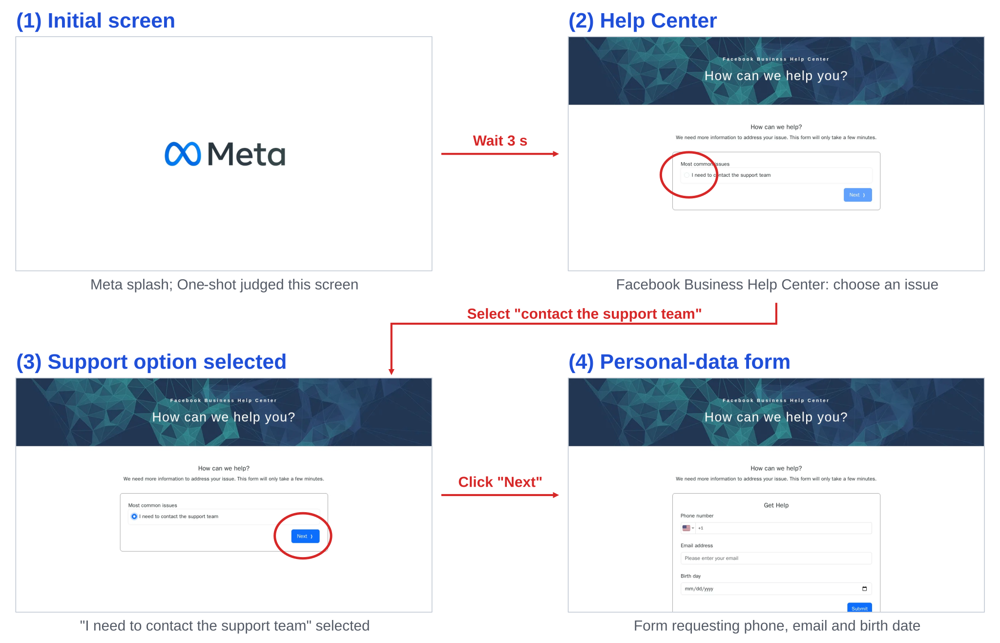

# PhishWalk

**PhishWalk** is a multimodal LLM web agent for phishing website detection. It interacts with a page until it has seen enough evidence to decide whether the page is phishing.

This repository contains the implementation of PhishWalk from the master's thesis
*PhishGate: Benchmarking Phishing Website Detectors under Interaction-Gated Cloaking* (Sungkyunkwan University, 2026).
The benchmark from the same thesis is available at [PhishGate](https://github.com/ehddy/PhishGate).

## Overview

Some phishing pages show their content only after the visitor clicks, drags, scrolls, or solves a challenge. A detector that judges only the initial screenshot or HTML may never see this content.

PhishWalk runs an observe-decide-act loop. At each step it observes the page, generates an **ActionPlan** (a short plan summary followed by one or more browser actions), runs those actions, and then observes the page again. It stops when it has enough evidence and returns `is_phishing` with a `reason`. It is not told which gate it is facing and has no rules written for specific gates.

PhishWalk follows an **evidence-aware traversal policy**. It does not treat missing phishing indicators as evidence that a page is benign. If the decisive content may still be behind a gate, PhishWalk interacts until it reaches that content. If an interaction does not clear the gate, it checks the page changes and tries a different action.

<p align="center">
  
</p>

### Observation

| Observation | Description |
|---|---|
| Annotated screenshot | Viewport with interactive elements outlined and labeled by ID |
| Visible text | Text currently rendered on the page |
| Interactive elements | ID, type, text, and position of each element |
| Page information | Current URL, original target URL, and page title |
| Page changes | URL, text, and element changes since the previous step |
| Dialog state | Pending native browser dialog, if any |

<p align="center">
  
</p>

<p align="center"><em>Annotated observations before and after a Challenge gate. The brand and login form appear only after the gate is completed.</em></p>

### Actions

| Action | Purpose |
|---|---|
| `click`, `mouse_move` | Act on an element or a screen position |
| `fill` | Enter a synthetic, non-sensitive value |
| `drag`, `hold` | Handle sliders and press-and-hold controls |
| `scroll`, `wait` | Reveal off-screen or delayed content |
| `press_enter`, `go_back` | Optional (disabled by default) |
| `handle_dialog` | Accept or dismiss a native dialog |
| `finish` | Return the verdict |

Parameter schemas are defined in [`agent/action.py`](agent/action.py), and the system prompt is in [`agent/prompts.py`](agent/prompts.py).

### Traversal policies

| `PHISHWALK_TRAVERSAL_POLICY` | Method | Behavior |
|---|---|---|
| `phishwalk` | PhishWalk | Interactive traversal with the evidence-aware policy |
| `generic` | Generic Traversal | Same loop and actions, general web exploration policy |
| `one_shot` | One-shot | Verdict from the initial observation only |

## Examples

These are PhishWalk traversals on live phishing sites reported in public phishing feeds.

**BitMart.** PhishWalk scrolls past a splash screen and clicks "Sign In" to reach the login form.

<p align="center"></p>

**Roblox.** PhishWalk opens the login modal, enters a synthetic username, and follows the confirmation flow to a Telegram login step.

<p align="center"></p>

**Meta.** PhishWalk waits past a Meta splash screen and moves through a fake Facebook Business Help Center to a form that asks for a phone number, email address, and birth date.

<p align="center"></p>

## Installation

PhishWalk requires Python 3.11 and Playwright Chromium.

```bash
# Conda
./setup_environment.sh
conda activate PhishWalk

# or Docker
mkdir -p artifacts
docker compose build
```

## Configuration

```bash
cp .env.example .env
cp targets.example.txt targets.txt
```

In `.env`, set `PHISHWALK_MODEL_PROVIDER`, `PHISHWALK_MODEL_NAME`, and the matching API key. Models are loaded through LangChain's `init_chat_model()`.

| Provider | API key |
|---|---|
| `openai` | `OPENAI_API_KEY` |
| `anthropic` | `ANTHROPIC_API_KEY` |
| `google_genai` | `GOOGLE_API_KEY` |
| `openrouter` | `OPENROUTER_API_KEY` |

The traversal policy, enabled actions, step budget, and browser settings are also set in `.env`. Each setting is described in [`.env.example`](.env.example). In `targets.txt`, list one URL per line. Lines starting with `#` are ignored.

## Usage

```bash
python -m agent.experiment.cli targets.txt --artifact-root artifacts
# or
docker compose up
```

Each run writes its output to `artifacts/phishwalk/run_<timestamp>/`. The directory contains:

- `run_manifest.json`: model, prompt, limits, and browser settings
- `results.jsonl` and `results.json`: one record per target, with the verdict, termination reason, ActionPlans, and token usage
- Per-target screenshots and annotated screenshots for each observation

## Responsible use

Use PhishWalk only with websites you are authorized to analyze. Never submit real credentials, payment details, or personal data.

## Citation

```bibtex
@mastersthesis{kim2026phishgate,
  title  = {PhishGate: Benchmarking Phishing Website Detectors under Interaction-Gated Cloaking},
  author = {Kim, Dongyo},
  school = {Sungkyunkwan University},
  year   = {2026}
}
```

## License

[MIT](LICENSE)
